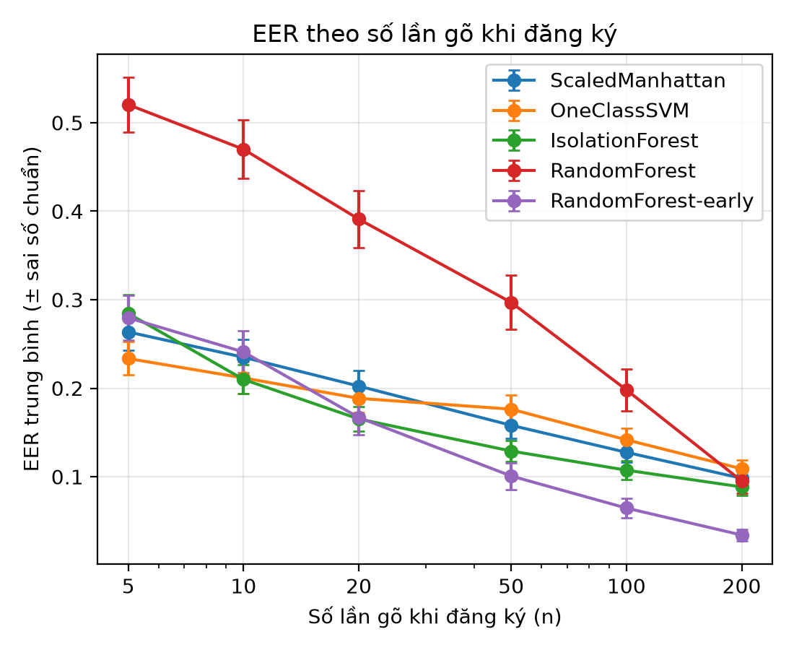
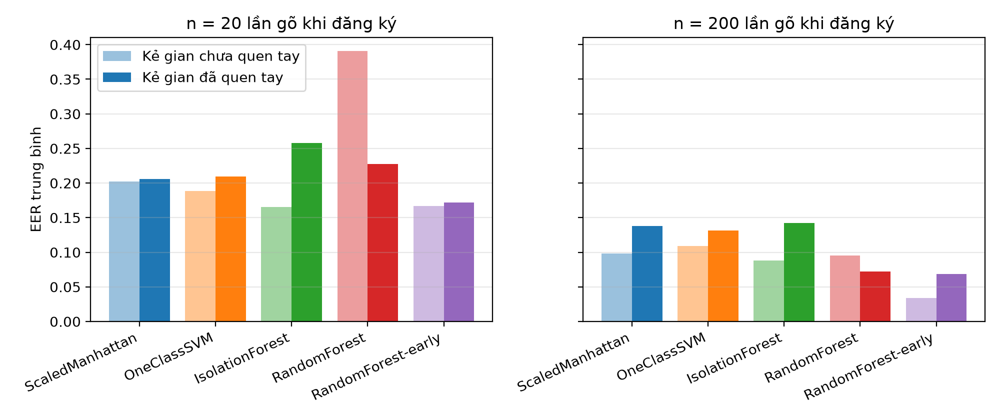
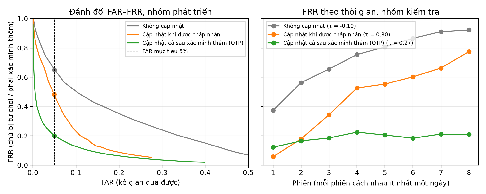
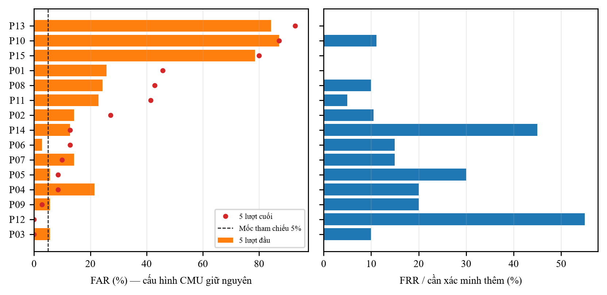

# KeyGuard — Xác thực người dùng qua nhịp gõ phím

Nghiên cứu lớp xác thực bổ sung qua nhịp gõ: mật khẩu đúng nhưng nhịp gõ không khớp sẽ cần xác minh thêm theo thiết kế.

KeyGuard học cách một người gõ câu `.tie5Roanl` + Enter. Main chứa thư viện và thực nghiệm; web trên `thu-branch` còn chờ sửa tích hợp, OTP và dữ liệu thật. Xem [bàn giao TV1](docs/TV1_HANDOFF.md) và [protocol](docs/EVALUATION_PROTOCOL.md).

Bài tập lớn môn **Học máy Ứng dụng** — Trường Đại học Văn Lang.

## Kết quả chính

Dữ liệu: CMU Keystroke Dynamics Benchmark, 51 người × 400 lần gõ × 8 phiên ở các ngày khác nhau.

**1. So sánh mô hình** (EER trung bình trên 51 người, càng thấp càng tốt). Học từ *n* lần gõ đầu, kiểm tra trên phiên 5–8. Kẻ gian "chưa quen tay" là 5 lần gõ đầu tiên của 25 người khác; kẻ gian "đã quen tay" là 5 lần gõ ở phiên 8 của chính những người đó.

| Mô hình | n = 20 | n = 20, kẻ gian đã quen tay | n = 200 | n = 200, kẻ gian đã quen tay | Thời gian học |
|---|---|---|---|---|---|
| Scaled Manhattan | 0,202 | **0,206** | 0,098 | 0,138 | **0,03 ms** |
| One-Class SVM | 0,189 | 0,209 | 0,109 | 0,131 | 1,01 ms |
| Isolation Forest | **0,165** | 0,258 | 0,088 | 0,142 | 122,07 ms |
| Random Forest | 0,391 | 0,228 | 0,095 | 0,072 | 152,33 ms |
| Random Forest (kẻ gian mẫu chưa quen tay) | 0,167 | 0,172 | **0,034** | **0,069** | 156,46 ms |

- EER đã nội suy tuyến tính tại FAR=FRR; timing là trung bình fit ở n=20, RF dùng một worker. Scaled Manhattan n=200 có EER 0,098 gần số công bố gốc; đây là đối chiếu, vì repo test 25 impostor còn [protocol gốc CMU](https://www.cs.cmu.edu/~keystroke/) dùng 50. Không khẳng định tái lập cùng protocol.
- Thời gian gõ giảm từ 3,06 giây ở phiên 1 còn 2,19 giây ở phiên 8, khoảng 28% (trung vị theo người rồi lấy trung bình). Cách lấy mẫu impostor ảnh hưởng kết quả; đây là dấu hiệu cần kiểm soát mức quen tay, chưa chứng minh quan hệ nhân quả.
- Scaled Manhattan ổn định nhất trước kẻ gian đã quen tay ở n = 20 và học lại nhanh hơn hàng nghìn lần, nên được chọn cho sản phẩm.

**2. Ngưỡng chung và cập nhật hồ sơ** (Scaled Manhattan, đăng ký 20 lần gõ, giữ 50 lần gần nhất). Ngưỡng chọn trên 36 người để FAR dev ≤ 5%; số liệu dưới thuộc 15 người không dùng chọn ngưỡng nhưng đã tham gia benchmark so sánh mô hình. Đây không phải holdout chưa từng được xem trong toàn quy trình.

| Chính sách cập nhật hồ sơ | Ngưỡng τ | FAR | FRR |
|---|---|---|---|
| Không cập nhật | −0,104 | 2,86% | 75,04% |
| Chỉ cập nhật khi được chấp nhận | 0,800 | 2,77% | 48,39% |
| **Cập nhật cả sau xác minh thêm** — mô phỏng fallback | **0,272** | **1,49%** | **19,21%** |

Kết quả chạy lại ngày 01/11/2026 sau khi sửa lịch thử impostor: ngay sau đăng ký và sau mỗi 50 lượt đăng nhập (đếm từ sau enrollment). Fallback giả định genuine luôn qua xác minh bổ sung, nên FRR là tỉ lệ cần bước này, không phải đo chất lượng OTP trên web. Static/fallback chọn tau có xử lý điểm trùng và kiểm tra FAR dev sau chọn; không bảo đảm FAR trên người mới. CSV/hình/cấu hình mới thay thế số cũ.

| | |
|---|---|
|  |  |



## Cấu trúc repo

```
keyguard-keystroke-auth/
├─ keyguard/                 # thư viện dùng chung
│  ├─ features.py            # sự kiện phím -> 31 đặc trưng (định dạng CMU)
│  ├─ detectors.py           # 4 bộ phát hiện: Scaled Manhattan, One-Class SVM, Isolation Forest, Random Forest
│  ├─ evaluation.py          # FAR, FRR, EER, AUC
│  ├─ model.py               # enroll() / verify() / update() cho web demo
│  └─ simulation.py          # mô phỏng chuỗi đăng nhập theo thời gian
├─ scripts/
│  ├─ run_benchmark.py       # so sánh các mô hình trên CMU
│  ├─ select_threshold.py    # chọn ngưỡng chung, ghi models/model_config.json
│  ├─ evaluate_collected.py  # đánh giá trên dữ liệu nhóm tự thu
│  ├─ make_report_figures.py # hình khổ một cột cho report
│  └─ make_sample_jsonl.py   # tạo dữ liệu mẫu để chạy thử
├─ models/model_config.json  # cấu hình mô hình mà web demo dùng
├─ results/                  # CSV/JSON kết quả
├─ figures/                  # hình (figures/report/: bản dùng trong report)
├─ report/KeyGuard_Report.docx  # bản thảo IEEE đã render 6 trang, còn chờ minh chứng TV2
├─ data/README.md            # nguồn dữ liệu, cách tải, định dạng JSONL
├─ tests/
└─ docs/                     # protocol và tài liệu bàn giao; web ở thu-branch
```

## Cách chạy

Python 3.11.

```bash
python -m venv .venv
.venv\Scripts\activate            # Windows  (macOS/Linux: source .venv/bin/activate)
pip install -r requirements.txt

curl -L -o data/raw/DSL-StrongPasswordData.csv https://www.cs.cmu.edu/~keystroke/DSL-StrongPasswordData.csv

python -m pytest -q                      # kiểm thử
python scripts/run_benchmark.py          # so sánh mô hình, ~3 phút   -> results/, figures/
python scripts/select_threshold.py       # chọn ngưỡng, ~2 phút      -> models/model_config.json
python scripts/audit_collected.py        # kiểm tra chất lượng/quy mô JSONL trước đánh giá
python scripts/evaluate_collected.py --data-kind collected  # chỉ khi có dữ liệu thật đủ mẫu
python scripts/make_report_figures.py    # vẽ hình cho report     -> figures/report/
```

Các thí nghiệm dùng `seed = 42`.

Kiểm tra hợp đồng mô hình bằng mẫu dựng từ CMU: `python scripts/smoke_model.py`. Kiểm tra pipeline: `python scripts/evaluate_collected.py --input "data/sample/*.jsonl" --data-kind cmu-derived --out-prefix pipeline_test_sample --allow-missing-timestamp --order session`; kết quả này không thay thế dữ liệu thu thật. Kết quả smoke ở `results/model_smoke.json`, kiểm thử ở `results/test_results.xml`.

Để tạo Word từ template và bảng/hình mới: `pip install -r requirements-report.txt`, rồi `python scripts/update_report.py`. Trên Windows có Word: `./scripts/render_report.ps1` để xuất PDF và kiểm tra số trang. Report vẫn ghi rõ các mục chờ dữ liệu/ảnh/live test thật.

## Dùng mô hình trong web demo

```python
from keyguard.model import enroll, verify, update, InvalidSampleError

# Đăng ký: người dùng gõ .tie5Roanl + Enter đủ n_enroll lần (20, xem models/model_config.json)
profile = enroll(samples)                    # profile là dict, lưu bằng JSON

# Đăng nhập (sau khi mật khẩu đúng):
try:
    confidence, accepted = verify(profile, events)
except InvalidSampleError:
    ...                                      # gõ sai câu: báo "gõ sai, thử lại"
if accepted:
    profile = update(profile, events)        # vào thẳng, cập nhật hồ sơ
else:
    ...                                      # hỏi thêm một bước xác minh (OTP mô phỏng)
    # nếu xác minh thêm thành công:
    profile = update(profile, events)        # vẫn cập nhật hồ sơ: đây đúng là chủ tài khoản
# lưu lại profile
```

- Mỗi lần gõ là danh sách sự kiện `{"key": ..., "type": "down"|"up", "t": ms}` (lấy `t` từ `performance.now()`).
- **Chỉ gọi `update` khi chắc chắn là chủ tài khoản** (được chấp nhận, hoặc qua bước xác minh thêm). Cập nhật bằng lần gõ của kẻ gian sẽ làm hồ sơ hỏng dần.
- `confidence` (0–1) dùng để hiển thị; bằng 0,5 đúng tại ngưỡng.
- `data/sample/sample_from_cmu.jsonl` có sẵn các lần gõ đúng định dạng để thử API khi chưa có dữ liệu thật.

## Dữ liệu

Xem [data/README.md](data/README.md). Snapshot10/11 từ nhánh web có601 dòng/15 mã; chưa đủ2 phiên40 lượt khác ngày. Phân tích chính loại4 dòng (hai khóa trùng P10 và hai mẫu thiếu thời gian), còn597 mẫu/297 genuine. Audit cũ `review_collected_audit.json` là lịch sử2 mẫu ngày01/11; audit mới ở `results/collected_audit.json`.

**Đánh giá sơ bộ trên bộ thu thật, cấu hình CMU giữ nguyên:** FRR49/297=**16,50%**, FAR5 mẫu đầu284/1050=**27,05%**, FAR5 mẫu cuối331/1050=**31,52%**. FAR không đạt mốc tham chiếu5%, không suy ra hiệu quả bảo mật trên web từ số CMU. Các lượt impostor chỉ chấm tại enrollment, không phải live test; không chỉnh tau sau khi xem kết quả. Xem [protocol, phân tích lỗi và độ nhạy](docs/COLLECTED_PRELIMINARY.md).



Tái lập snapshot: `git fetch origin thu-branch`, `python scripts/import_collected.py`; sau đó chạy `python scripts/evaluate_collected.py --input "data/collected/*.jsonl" --data-kind collected --out-prefix collected_preliminary` và `python scripts/analyze_collected.py` (script phân tích cần cả nhánh độ nhạy, lệnh đầy đủ trong tài liệu). SHA-256 raw ở `data/collected_manifest.json`. Report vẫn chờ ảnh sử dụng/live test, nhưng đã có bảng/hình dữ liệu tự thu.

Main chỉ bàn giao mã, manifest, bảng tổng hợp/hình và report; snapshot sự kiện thô `data/collected/` và CSV genuine từng lượt được giữ local/ignore. Tái lập bằng lệnh import từ commit nguồn có sẵn; không giả định dữ liệu raw đã có trong checkout main.

## Phân công

| Thành viên | Phụ trách |
|---|---|
| Nhật (TV1) | Đặc trưng, mô hình, đánh giá, chọn ngưỡng, report |
| Thư (TV2) | Thu dữ liệu, API, web demo, thử nghiệm thực tế |
