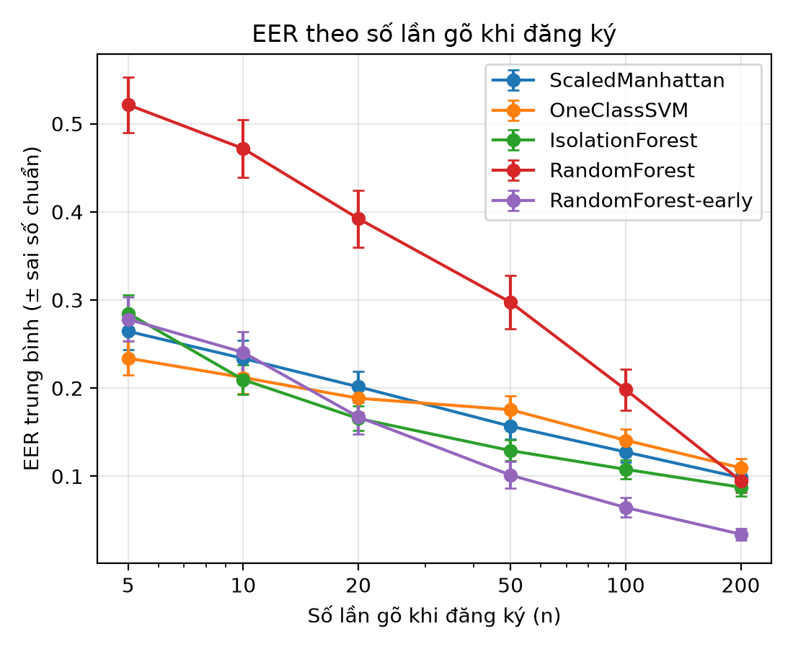
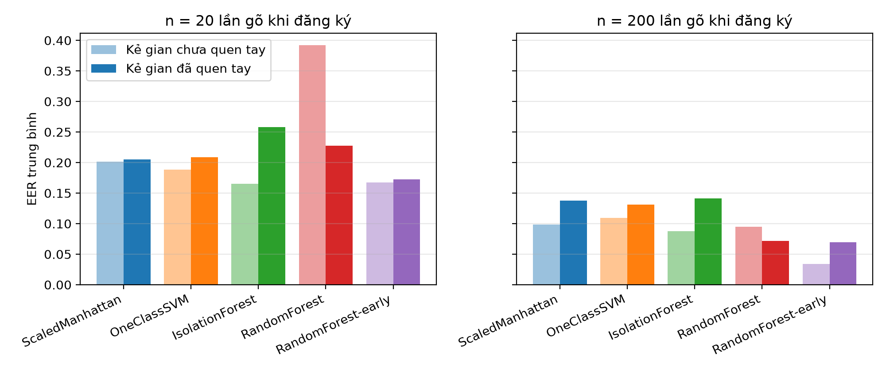
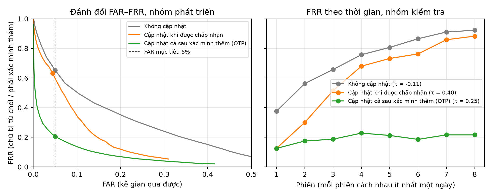

# KeyGuard — Xác thực người dùng qua nhịp gõ phím

Người khác gõ đúng mật khẩu vẫn bị từ chối, vì nhịp gõ không giống chủ tài khoản.

KeyGuard học cách một người gõ câu `.tie5Roanl` (thời gian giữ từng phím, khoảng cách giữa các phím) rồi dùng nhịp gõ đó làm lớp xác thực thứ hai, sau mật khẩu.

Bài tập lớn môn **Học máy Ứng dụng** — Trường Đại học Văn Lang.

## Kết quả chính

Dữ liệu: CMU Keystroke Dynamics Benchmark, 51 người × 400 lần gõ × 8 phiên ở các ngày khác nhau.

**1. So sánh mô hình** (EER trung bình trên 51 người, càng thấp càng tốt). Học từ *n* lần gõ đầu, kiểm tra trên phiên 5–8. Kẻ gian "chưa quen tay" là 5 lần gõ đầu tiên của 25 người khác; kẻ gian "đã quen tay" là 5 lần gõ ở phiên 8 của chính những người đó.

| Mô hình | n = 20 | n = 20, kẻ gian đã quen tay | n = 200 | n = 200, kẻ gian đã quen tay | Thời gian học |
|---|---|---|---|---|---|
| Scaled Manhattan | 0,201 | **0,205** | 0,098 | 0,138 | **0,06 ms** |
| One-Class SVM | 0,189 | 0,209 | 0,110 | 0,131 | 2 ms |
| Isolation Forest | **0,165** | 0,258 | 0,088 | 0,141 | 201 ms |
| Random Forest | 0,392 | 0,227 | 0,095 | 0,072 | 306 ms |
| Random Forest (kẻ gian mẫu chưa quen tay) | 0,167 | 0,173 | **0,034** | **0,069** | 287 ms |

- Scaled Manhattan với n = 200 cho EER 0,098, khớp với 0,096 trong bài gốc của Killourhy & Maxion (2009). Quy trình đánh giá tái lập được kết quả đã công bố.
- Người dùng gõ nhanh dần theo thời gian: cả câu mất 3,26 giây ở phiên 1, còn 2,29 giây ở phiên 8. Mô hình nào dựa vào "mức quen tay" thay vì "ai đang gõ" sẽ tụt khi kẻ gian đã luyện gõ (Isolation Forest, Random Forest).
- Scaled Manhattan ổn định nhất trước kẻ gian đã quen tay ở n = 20 và học lại nhanh hơn hàng nghìn lần, nên được chọn cho sản phẩm.

**2. Ngưỡng chung và cập nhật hồ sơ** (Scaled Manhattan, đăng ký 20 lần gõ, giữ 50 lần gần nhất). Ngưỡng chọn trên 36 người để FAR ≤ 5%; số liệu dưới là của 15 người kiểm tra chưa từng dùng khi chọn ngưỡng.

| Chính sách cập nhật hồ sơ | Ngưỡng τ | FAR | FRR |
|---|---|---|---|
| Không cập nhật | −0,11 | 2,9% | 75,1% |
| Chỉ cập nhật khi được chấp nhận | 0,40 | 1,8% | 63,2% |
| **Cập nhật cả sau xác minh thêm (OTP)** — dùng trong sản phẩm | **0,25** | **1,5%** | **19,6%** |

Với chính sách thứ ba (xác thực theo rủi ro), khoảng 4/5 lần đăng nhập của chủ tài khoản vào thẳng; lần còn lại phải xác minh thêm. FRR giữ ổn định quanh 20% suốt 8 phiên, trong khi hai chính sách kia tăng lên gần 90%.

| | |
|---|---|
|  |  |



## Cấu trúc repo

```
keyguard-keystroke-auth/
├─ keyguard/                 # thư viện dùng chung
│  ├─ features.py            # sự kiện phím -> 31 đặc trưng (định dạng CMU)
│  ├─ detectors.py           # 4 bộ phát hiện: Scaled Manhattan, One-Class SVM, Isolation Forest, Random Forest
│  ├─ evaluation.py          # FAR, FRR, EER, AUC
│  ├─ model.py               # enroll() / verify() / update() cho web demo
│  └─ simulation.py          # mô phỏng chuỗi đăng nhập theo thời gian
├─ scripts/
│  ├─ run_benchmark.py       # so sánh các mô hình trên CMU
│  ├─ select_threshold.py    # chọn ngưỡng chung, ghi models/model_config.json
│  ├─ evaluate_collected.py  # đánh giá trên dữ liệu nhóm tự thu
│  └─ make_sample_jsonl.py   # tạo dữ liệu mẫu để chạy thử
├─ models/model_config.json  # cấu hình mô hình mà web demo dùng
├─ results/                  # CSV/JSON kết quả
├─ figures/                  # hình cho report
├─ data/README.md            # nguồn dữ liệu, cách tải, định dạng JSONL
├─ tests/
├─ collector/                # web thu dữ liệu (TV2)
└─ app/                      # web demo (TV2)
```

## Cách chạy

Python 3.11.

```bash
python -m venv .venv
.venv\Scripts\activate            # Windows  (macOS/Linux: source .venv/bin/activate)
pip install -r requirements.txt

curl -L -o data/raw/DSL-StrongPasswordData.csv https://www.cs.cmu.edu/~keystroke/DSL-StrongPasswordData.csv

python -m pytest -q                      # kiểm thử
python scripts/run_benchmark.py          # so sánh mô hình, ~3 phút   -> results/, figures/
python scripts/select_threshold.py       # chọn ngưỡng, ~2 phút      -> models/model_config.json
python scripts/evaluate_collected.py     # khi đã có dữ liệu tự thu trong data/collected/
```

Mọi script dùng `seed = 42`.

## Dùng mô hình trong web demo

```python
from keyguard.model import enroll, verify, update, InvalidSampleError

# Đăng ký: người dùng gõ .tie5Roanl + Enter đủ n_enroll lần (20, xem models/model_config.json)
profile = enroll(samples)                    # profile là dict, lưu bằng JSON

# Đăng nhập (sau khi mật khẩu đúng):
try:
    confidence, accepted = verify(profile, events)
except InvalidSampleError:
    ...                                      # gõ sai câu: báo "gõ sai, thử lại"
if accepted:
    profile = update(profile, events)        # vào thẳng, cập nhật hồ sơ
else:
    ...                                      # hỏi thêm một bước xác minh (OTP mô phỏng)
    # nếu xác minh thêm thành công:
    profile = update(profile, events)        # vẫn cập nhật hồ sơ: đây đúng là chủ tài khoản
# lưu lại profile
```

- Mỗi lần gõ là danh sách sự kiện `{"key": ..., "type": "down"|"up", "t": ms}` (lấy `t` từ `performance.now()`).
- **Chỉ gọi `update` khi chắc chắn là chủ tài khoản** (được chấp nhận, hoặc qua bước xác minh thêm). Cập nhật bằng lần gõ của kẻ gian sẽ làm hồ sơ hỏng dần.
- `confidence` (0–1) dùng để hiển thị; bằng 0,5 đúng tại ngưỡng.
- `data/sample/sample_from_cmu.jsonl` có sẵn các lần gõ đúng định dạng để thử API khi chưa có dữ liệu thật.

## Dữ liệu

Xem [data/README.md](data/README.md). Bộ CMU Keystroke Dynamics Benchmark (Killourhy & Maxion, 2009) và dữ liệu nhóm tự thu qua web, đã ẩn danh.

## Phân công

| Thành viên | Phụ trách |
|---|---|
| Nhật (TV1) | Đặc trưng, mô hình, đánh giá, chọn ngưỡng, report |
| Thư (TV2) | Thu dữ liệu, API, web demo, thử nghiệm thực tế |
