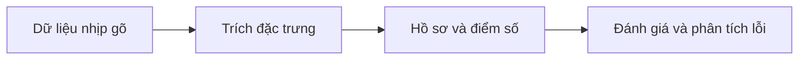

# KeyGuard

**Xác thực người dùng qua nhịp gõ phím với cập nhật hồ sơ thích nghi**

Bài tập lớn môn Học máy Ứng dụng · Trường Đại học Văn Lang

[Báo cáo PDF](reports/KeyGuard_BaoCao_NopLai_v10_20261124.pdf) · [Bản Word](reports/KeyGuard_BaoCao_NopLai_v10_20261124.docx) · [Hướng dẫn đọc](docs/READING_GUIDE.md) · [Phân công thực hiện](docs/MA_NGUON_VA_PHAN_CONG.md)

## Bài toán

Một người biết đúng mật khẩu vẫn có thể gõ khác chủ tài khoản. KeyGuard khảo sát thời gian giữ phím và khoảng cách giữa các lần nhấn, nhả để bổ sung tín hiệu hành vi cho việc xác thực.

Nhóm quan tâm đến hai câu hỏi: cấu hình chọn trên dữ liệu chuẩn có dùng được cho dữ liệu tự thu không, và các thay đổi trong đăng ký, chuẩn hóa điểm hoặc cập nhật hồ sơ có giúp giảm lỗi một cách nhất quán không?



## Nhóm đã thực hiện

- **Thư viện nhịp gõ:** trích 31 đặc trưng cho chuỗi cố định, so sánh bốn họ mô hình và ba cách cập nhật hồ sơ.
- **Ứng dụng web:** thu mẫu, đăng ký, đăng nhập, OTP mô phỏng; kiểm tra đầu vào, chống lưu mẫu hai lần và hỗ trợ PostgreSQL.
- **Thực nghiệm:** so sánh trên CMU, đánh giá sơ bộ dữ liệu tự thu, đối chứng trên KeyRecs/GREYC-Web và kiểm tra quy tắc cố định trên USN.
- **Phân tích chuẩn hóa:** tái lập một cơ chế lỗi CV, giải thích bằng đại số và xây bước kiểm tra mẫu đăng ký ở mức thử nghiệm nghiên cứu.

## Kết quả chính

FAR là tỷ lệ nhận nhầm; FRR là tỷ lệ chính chủ không được nhận trực tiếp tại ngưỡng đang xét.

| Phép đánh giá | FAR | FRR | Nguồn kết quả |
|---|---:|---:|---|
| CMU — mô phỏng fallback | 1,49% | 19,21% | [Bảng ngưỡng](research/results/threshold_selection.csv) |
| Dữ liệu tự thu — 597 mẫu, 15 người | 27,05–31,52% | 16,50% | [Tổng hợp tự thu](research/results/collected_preliminary_summary.json) |
| USN — quy tắc cố định, 5 người và 6 câu | 13,65% | 32,81% | [Kết quả USN](research/docs/USN_TRANSFER_RESULTS_20261124.md) |

Mỗi hàng có cách chia dữ liệu và lịch chấm riêng; chi tiết nằm trong báo cáo và protocol. Mô phỏng fallback dùng giả định xác minh bổ sung đáng tin cậy khi cập nhật hồ sơ.

Kết quả cho thấy mức lỗi thấp trên CMU chưa giữ được khi chuyển sang dữ liệu tự thu. Các đối chứng chưa tìm được cải tiến đồng thời FAR–FRR nhất quán giữa các nguồn.

Phần [chẩn đoán CV](research/docs/USN_SENSITIVITY_RESULTS_20261124.md) xác định ba hồ sơ có chuẩn hóa quá dễ nhận. Bước kiểm tra thử nghiệm chuyển thêm 1.020 quyết định giả mạo sang xác minh, đồng thời thêm 540 lượt chính chủ cũng cần xác minh; vẫn còn 374 quyết định giả mạo qua bước nhịp gõ. Đây là [phân tích tuyến xử lý hồi cứu](research/docs/CALIBRATION_ROUTING_RESULTS_20261124.md), chưa có kết quả OTP để tính FAR/FRR cuối cùng của toàn hệ thống.

Hai kiểm tra bổ sung giúp làm rõ phạm vi của bước cảnh báo:

- [Audit trên DEV](research/docs/PREFLIGHT_DEV_AUDIT_RESULTS_20261124.md): không có cảnh báo ở 36 hồ sơ CMU và 66 hồ sơ KeyRecs, dùng 2.040 mẫu đăng ký. Đây chưa phải tỷ lệ nhận nhầm bằng 0 hoặc chứng nhận an toàn.
- [Chẩn đoán phần nhận nhầm còn lại](research/docs/USN_RESIDUAL_DIAGNOSTIC_RESULTS_20261124.md): 305/374 quyết định thuộc các hồ sơ đích mang mã `participant5`. Hai hồ sơ lớn nhất có AUC 0,9424 và 0,8670, cho thấy cần phân biệt xếp hạng với quyết định tại ngưỡng. Phân tích dùng điểm đã lưu, không chọn ngưỡng mới.

## Bắt đầu nhanh

Clone đúng nhánh nộp bài và kiểm các tệp công khai. Lệnh kiểm tra chỉ cần Python, chưa cần cài thư viện ngoài:

```powershell
git clone --branch submission/final-20261119 https://github.com/MinhNhat-2504/keyguard-keystroke-auth.git
cd keyguard-keystroke-auth
python verify_submission.py
```

Để chạy ứng dụng và các kiểm thử, dùng Python 3.11 và bộ thư viện đã kiểm:

```powershell
python -m venv .venv
.\.venv\Scripts\python.exe -m pip install -r validation/requirements-tested.txt
```

Chạy web bằng file storage riêng cho local:

```powershell
cd web
$env:PYTHONUTF8 = '1'
$env:KEYGUARD_STORAGE = 'file'
$env:DATABASE_URL = ''
$env:KEYGUARD_DATA_DIR = Join-Path $PWD 'local-test-data'
..\.venv\Scripts\python.exe app.py
```

Mở **http://127.0.0.1:5000**. Phần đăng ký cần 20 lượt hợp lệ của chuỗi `.tie5Roanl` và Enter; OTP là mô phỏng.

[Hướng dẫn chạy và đối chiếu kết quả](docs/RUNNING_AND_REPRODUCIBILITY.md) ghi các lệnh kiểm thử, audit và đầu vào cần có khi chạy lại nghiên cứu.

## Cấu trúc mã nguồn

```text
reports/       Báo cáo Word và PDF
research/      Thư viện, thực nghiệm, protocol và kết quả nghiên cứu
web/           Ứng dụng Flask và kiểm thử API
evidence/      Ảnh, nhật ký và hồ sơ vận hành
docs/          Hướng dẫn đọc, chạy và phân công
validation/    Hồ sơ kiểm tra và thư viện đã kiểm
```

`research/` và `web/` giữ các phần mã tương ứng với phạm vi đã đánh giá. [SOURCE_MANIFEST.json](SOURCE_MANIFEST.json) ghi hash các tệp trong bản nộp.

## Phạm vi và giới hạn

Dữ liệu tự thu chủ yếu một phiên nên chưa chứng minh độ ổn định qua nhiều ngày. USN có 5 người tạo 30 hồ sơ người–câu; các quyết định chấm lặp không phải các cá nhân độc lập. Bước kiểm tra chuẩn hóa mới nằm trong phần nghiên cứu, chưa tích hợp vào web.

Repo có mã nguồn, kết quả đã lưu và dữ liệu giả để kiểm logic. Raw tự thu, tài khoản thực, OTP và thông tin kết nối riêng được giữ ngoài bản công khai. Đối chiếu được kết quả lưu không đồng nghĩa đã chạy lại toàn bộ mô hình từ raw.

## Nhóm thực hiện

| Sinh viên | MSSV |
|---|---|
| Trịnh Ngọc Minh Nhật | 2474802010280 |
| Nguyễn Anh Thư | 2474802010381 |

**Giảng viên hướng dẫn:** Nguyễn Thái Anh.

Bản nộp cập nhật ngày **24/11/2026**. Các báo cáo trước được giữ trong [reports/](reports/) để đối chiếu.
