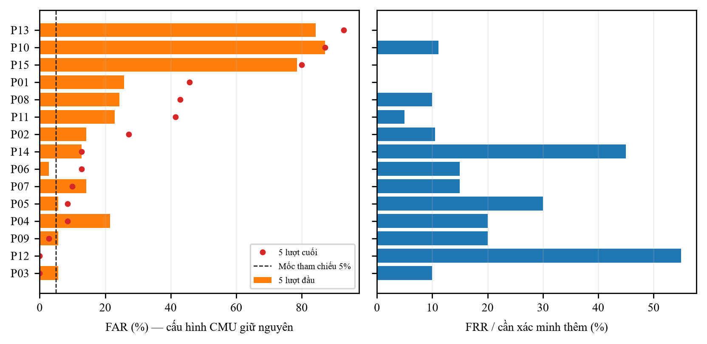

# Đánh giá sơ bộ dữ liệu tự thu — 10/11/2026

## Nguồn, protocol và cách xử lý dữ liệu

Snapshot nguyên byte từ `thu-branch`, commit `44a610bd120b09e2838e76073cb164c3ce6cac36`: 15 file, 601 dòng; SHA-256 từng file trong `data/collected_manifest.json`. Không sửa hay đánh số lại dữ liệu gốc. Số mã không tự chứng minh số người khác nhau; tên người không nằm trong snapshot. Mẫu đồng ý và ghi chú thu nằm ở nhánh nguồn; chưa đối chiếu xác nhận từng mã hoặc bàn phím/thiết bị.

Snapshot và CSV genuine từng lượt chỉ giữ local/ignore, không đưa payload sự kiện thô hoặc bảng từng lượt vào commit bàn giao main. Repo GitHub là public; gói này gồm code/manifest/tổng hợp/hình/report. Dùng import từ commit nguồn khi cần tái lập trong môi trường được phép; không coi README là xác nhận quyền công bố mọi dữ liệu người tham gia.

Phân tích chính xác định trước khi đọc kết quả: loại cả hai dòng P10/session1/rep29 vì khóa mơ hồ, loại hai mẫu cũ thiếu collected_at (P01 dòng1 và P02 dòng1). Không tự đoán dòng P10 thứ39 phải có rep39. Còn **597 mẫu ở 15 mã**; P01=40, P02=39, P10=38, các mã khác40. Nhật ký loại mẫu ở `results/collected_preliminary_exclusions.json`.

Thứ tự dùng collected_at chuyển UTC, không dùng rep khi mâu thuẫn. Mỗi người dùng20 mẫu đầu enroll, phần còn lại genuine test: **297 lượt**. Mô hình Scaled Manhattan, n20/window50, CV5, fallback và **tau=0,2720094565367825** từ CMU giữ nguyên, không fit lại tau trên bộ thu. Hash cấu hình trong summary. Fallback giả định chính chủ luôn vượt bước xác minh bổ sung; mẫu impostor không cập nhật hồ sơ. Không kiểm thử OTP thực tế trong thí nghiệm này.

Impostor cho mỗi tài khoản là14 mã khác ×5 lượt =70 điểm cho mỗi kịch bản. Kịch bản “đầu/cuối” chỉ có nghĩa **5 mẫu đầu/5 mẫu cuối bộ thu của người khác**, chưa đủ căn cứ gọi là chưa/đã luyện thành thạo. Mỗi tài khoản có18–20 lượt genuine sau enroll, chưa đạt mốc50: impostor chỉ được thử **ngay sau enrollment**, một checkpoint. Tổng mỗi kịch bản15×70=1.050 điểm. Các mẫu cùng người được dùng qua nhiều tài khoản; không coi1.050 điểm là1.050 người/tấn công độc lập.

Tất cả mẫu được giữ sau lọc là session1. P10/session1 trải qua hai ngày, không tạo ra hai phiên40 mẫu; các mã khác chủ yếu cùng ngày. Vì vậy không có kết quả kiểm định drift nhiều phiên/ngày. Người cùng bộ có thể làm genuine và impostor cho các tài khoản khác; đây là mô phỏng cùng cohort, chưa phải thử người tấn công mới hoặc live test qua web.

## Kết quả cố định, không điều chỉnh theo test

| Chỉ số | Tử số / mẫu số | Kết quả |
|---|---:|---:|
| Genuine cần xác minh thêm (FRR fallback) | 49 / 297 | **16,50%** |
| Impostor được nhận, 5 mẫu đầu | 284 / 1.050 | **27,05%** |
| Impostor được nhận, 5 mẫu cuối | 331 / 1.050 | **31,52%** |
| EER trung bình theo tài khoản, kịch bản đầu | 15 tài khoản | 15,81% |
| EER trung bình theo tài khoản, kịch bản cuối | 15 tài khoản | 18,90% |

EER là chỉ số ROC nội suy để mô tả khả năng xếp hạng, không phải lỗi tại ngưỡng sản phẩm và không dùng để thay tau. Genuine được chấm tuần tự với hồ sơ cập nhật, impostor ở hồ sơ enrollment theo protocol checkpoint trên; EER kết hợp các điểm ở các trạng thái hồ sơ này, không phải một ROC của một hồ sơ tĩnh duy nhất.

So với kết quả CMU cùng cấu hình: FAR1,49%, FRR19,21%. Genuine trong bộ mới có tỷ lệ cần xác minh tương đương/thấp hơn, nhưng FAR tăng rất mạnh và **không đạt mức tham chiếu5%**. Hai nguồn khác người, thiết bị/thu thập, số phiên, lượng test và impostor; so sánh chỉ có tính mô tả, không phải kiểm định nhân quả. Không thể khẳng định cấu hình hiện tại an toàn để xác thực thực tế chỉ từ FAR CMU.



## Phân tích lỗi

- **P10:** FAR61/70=87,14% ở cả hai kịch bản; **P13:** FAR59/70=84,29% đầu và65/70=92,86% cuối; **P15:**55/70=78,57% đầu và56/70=80% cuối. Mô hình hồ sơ của các mã này chấp nhận quá rộng; FRR thấp của P13/P15 không đồng nghĩa nhận diện tốt. Cần xác minh người/điều kiện thu và tập hiệu chỉnh độc lập trước khi đề xuất ngưỡng khác.
- **P12:**11/20 genuine bị yêu cầu xác minh=55%, trong khi không nhận impostor ở70 điểm mỗi kịch bản; **P14:**9/20=45%. Đánh đổi bảo mật/tiện dụng rất không đồng đều giữa tài khoản.
- Trung vị thời gian cả câu theo mã dao động khoảng2,56–9,64 giây (`results/collected_diagnostics.csv`). Điều này cho thấy độ đa dạng nhịp gõ, nhưng không xác định được nguyên nhân do thiết bị hay kinh nghiệm vì thiếu metadata. Bảng chẩn đoán cũng ghi thống kê score chuẩn hóa của enrollment, không dùng những số này để chọn ngưỡng theo test.
- Phân tích theo phiên chỉ có một session giữ lại; file `collected_preliminary_by_session.csv` không chứng minh độ ổn định qua ngày. Các lượt của cùng người và hồ sơ không độc lập; không tính khoảng tin cậy nhị thức với giả định mọi điểm độc lập.

## Độ nhạy với khóa trùng P10

Phân tích phụ giữ dòng xuất hiện trước của P10/rep29, vẫn loại hai mẫu không thời gian và sắp theo timestamp:598 mẫu,298 genuine,49 lần bị từ chối → FRR16,44%; FAR đầu/cuối vẫn27,05%/31,52%. EER đầu trung bình15,37%, cuối18,90%. Kết luận về FAR cao không thay đổi trong hai cách xử lý đã công bố. Không chọn một cách vì nó cho điểm đẹp hơn; phân tích chính vẫn loại cả nhóm khóa mơ hồ. File `results/collected_sensitivity.csv` lưu đối chiếu.

## Tái lập

```powershell
git fetch origin thu-branch
python scripts/import_collected.py
python scripts/audit_collected.py
python scripts/evaluate_collected.py --input "data/collected/*.jsonl" --data-kind collected --out-prefix collected_preliminary
python scripts/evaluate_collected.py --input "data/collected/*.jsonl" --data-kind collected --out-prefix collected_sensitivity_first --duplicate-policy first
python scripts/analyze_collected.py
```

Import chỉ dùng commit cố định đã có ở Git local, không tải ngầm và không ghi đè file khác snapshot. CLI chính mặc định exclude-all/require timestamp/order timestamp; với dữ liệu CMU-derived không timestamp phải thêm `--allow-missing-timestamp --order session`. Bảng theo người có tử số/mẫu số; bảng genuine từng lượt ghi source_file/source_line để truy vết. Không xuất score matrix có thông tin danh tính thật.

## Việc còn lại

Thư cần đối chiếu trùng P10, thu đủ phiên/ngày và metadata/đồng ý, bàn giao ảnh và live_test.csv. Nhật có thể hoàn thành phân tích sơ bộ này nhưng chưa thay được yêu cầu nhiều phiên và live test. Nếu muốn hiệu chỉnh cho miền trình duyệt, phải thiết kế dev/test theo người/phiên mới và chỉ chọn tau từ dev; không tiếp tục dùng bộ đã xem này như test chưa bị xem.
